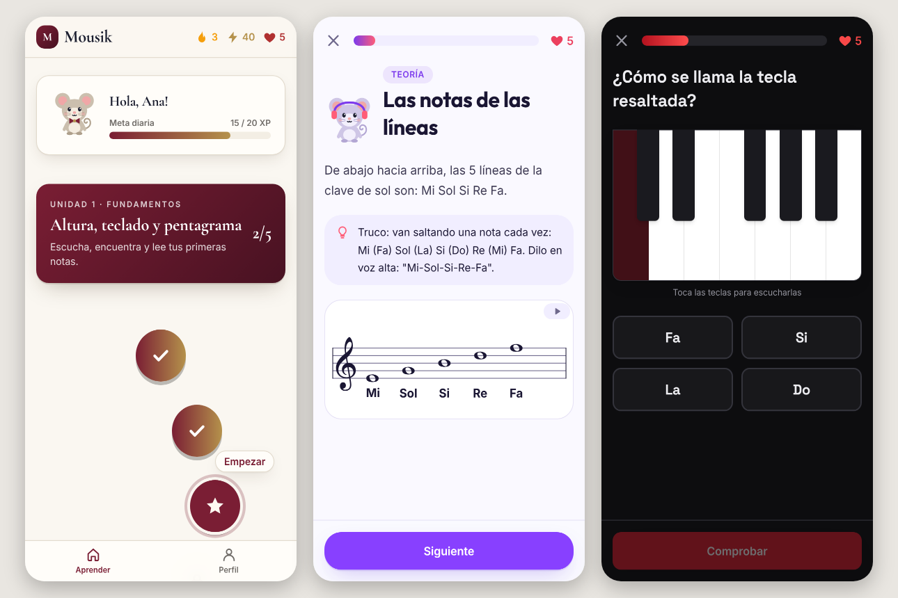

# Mousik 🎹🐭



App web (y móvil, instalable como PWA) estilo Duolingo para aprender **teoría musical y composición desde cero hasta experto**. El objetivo final es que la persona componga su propia pieza.

- **Bilingüe**: español / inglés.
- **Notación a elegir**: Do-Re-Mi o C-D-E.
- **Género a elegir** (clásica, pop, rock): cambia el tema visual, el atuendo de la mascota, los consejos de cada lección y, en las unidades avanzadas, los ejercicios y el proyecto final.
- **Mo**, la mascota: un ratón cuya cola tiene forma de clave de sol 🎼.
- **Gamificación**: XP, rachas, meta diaria, corazones, mapa de lecciones y repetición de errores al final de cada lección.
- **Instrumentos de cada género**: el piano es el "mapa" para la teoría; en la práctica y los ejercicios suenan los instrumentos del género elegido:
  - Clásica: violín, violonchelo, contrabajo, flauta, clarinete, fagot, trompeta, trompa, arpa.
  - Pop: piano eléctrico, sintetizador solista, pad, guitarra acústica, bajo eléctrico, batería.
  - Rock: guitarra distorsionada y limpia, bajo eléctrico, batería, órgano.
- **Muestras reales alojadas en la app** (`public/samples`, CC-BY 3.0, ver créditos) + sintetizadores y batería generados con Tone.js. **Partituras** con VexFlow.

## Puesta en marcha

```bash
npm install
npm run dev             # http://localhost:5173 (modo invitado, sin backend)
```

Con backend local (requiere Docker): `npx supabase start`, copia `.env.example` a `.env.local` con la clave que imprime, y `npm run dev`.

Ambientes (DEV/QA/PROD), ciclo de desarrollo, CI/CD, seguridad y configuración de cuentas: **[docs/DEVOPS.md](docs/DEVOPS.md)**.

## Scripts

| Comando | Qué hace |
|---|---|
| `npm run dev` | Servidor de desarrollo |
| `npm run build` | Compilación de producción (+ service worker PWA) |
| `npm run preview` | Sirve la compilación |
| `npm run validate` | Verifica el contenido: una respuesta correcta por ejercicio, registros de instrumentos y catálogo del servidor |
| `npm test` | Tests unitarios (Vitest) |
| `npm run size` | Presupuesto de peso del bundle (tras `npm run build`) |
| `npx supabase test db` | Tests de seguridad de la base de datos (RLS, funciones) |

## Estructura

```
docs/CURRICULUM.md        Currículo completo investigado (8 unidades, 45 lecciones, proyecto final por género)
src/content/              Contenido de las lecciones (bilingüe)
  course.ts               Mapa de unidades
  unit1.ts                Unidad 1 completa
  types.ts                Tipos de tarjetas de teoría y ejercicios
src/exercises/build.ts    Convierte un ejercicio en una pregunta (opciones barajadas, distractores)
src/components/           Mascota, Piano, Pentagrama (VexFlow), iconos…
src/pages/                Bienvenida, Login, Onboarding, Mapa (Home), Lección, Perfil
src/lib/                  Audio multi-instrumento (Tone.js), catálogo de instrumentos, teoría, i18n, auth, sync
public/samples/           Muestras de instrumentos + manifest.json + CREDITS.md
src/store/useStore.ts     Estado (ajustes, XP, racha, corazones, progreso)
supabase/migrations/      Esquema de la base de datos (RLS, funciones de progreso validadas)
supabase/tests/           Tests de seguridad pgTAP
.github/workflows/        CI (PR), Deploy (DEV/QA/PROD), backup nocturno
```

### Cómo escribir lecciones

Cada lección tiene tarjetas de teoría (`cards`) y ejercicios (`exercises`). Los textos admiten:
- `**negrita**`
- `{n:C#}` → se muestra como **C♯** o **Do♯** según la notación del usuario.

Tipos de ejercicio disponibles: `choice`, `name-note` (leer en pentagrama), `name-key` (nombrar tecla), `play-note` (tocar en el piano), `ear-compare` (agudo/grave, también entre dos instrumentos), `identify-instrument` (¿qué instrumento suena?).

**Instrumentos en el contenido** (`instrument` en ejercicios y demos):
- `'auto'` (por defecto en ejercicios): rota entre los instrumentos del género que pueden tocar esas notas; en lectura de pentagrama prefiere los que leen esa clave.
- `'role:bass' | 'role:lead' | 'role:chords'`: el instrumento que cumple ese papel en el género.
- Un id concreto (`'cello'`, `'guitar-distortion'`…). Sin indicar nada, la teoría suena en piano.
- Una lección puede tener `variants` por género (ver `src/content/unit1-instruments.ts`).

Las muestras se regeneran con `python3 scripts/fetch-samples.py` (requiere ffmpeg).

## Hoja de ruta

- [x] Unidad 1: altura, teclado y pentagrama (6 lecciones, incluida "Los instrumentos de tu género")
- [x] Motor multi-instrumento por género
- [x] "Tu canción": cada lección termina con un paso creativo (sin respuestas incorrectas) que añade una pieza a la canción del alumno; página *Mi canción*
- [ ] Unidad 2: ritmo y compás (ejercicios de tap rítmico)
- [ ] Unidades 3–7: intervalos, escalas, acordes, armonía, melodía
- [ ] Unidad 8: forma y composición + editor de composición y proyecto final
- [ ] Repaso espaciado (ver `docs/CURRICULUM.md` §5)
